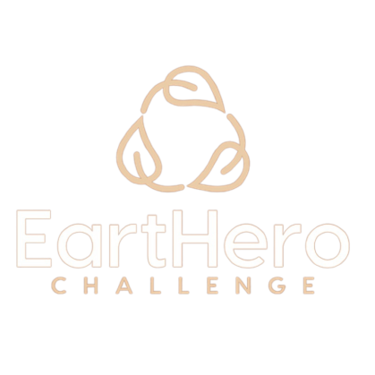

# EartHero

Atualmente, o planeta sofre com resquícios de poluição e é importante que as pessoas comecem a aderir práticas de vida sustentáveis diminuindo os impactos ambientais causados por anos de inconsciência ganância do ser humano. A ideia do tema consiste em transformar a reciclagem em uma prática divertida, por meio de uma competição amigável e recompensante, também trazendo informações que auxiliam em como ter uma vida sustentável.
<p align="center">
  
</p>
## Índice

- [Visão Geral](#visão-geral)
- [Funcionalidades](#funcionalidades)
- [Instalação](#instalação)
- [Como Usar](#como-usar)
- [Contribuição](#contribuição)
- [Autores](#autores)
- [Licença](#licença)

## Visão Geral

Uma breve explicação sobre o que seu projeto faz e por que é útil.

## Funcionalidades

Destaque as principais funcionalidades do seu projeto.

- Funcionalidade 1
- Funcionalidade 2
- ...

## Instalação

Forneça instruções claras sobre como instalar e configurar o seu projeto. Inclua exemplos sempre que possível.

```bash
git clone https://github.com/seu-usuario/seu-projeto.git
cd seu-projeto
npm install
