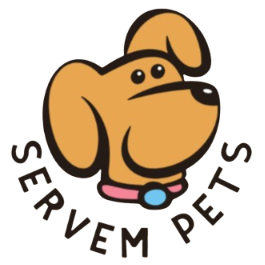

# Nome do Projeto

Breve descrição do projeto em uma ou duas frases cativantes.

[]

## Visão Geral

Descreva aqui o propósito e a funcionalidade principal do seu projeto de forma mais detalhada. Explique por que é útil e como pode beneficiar os usuários.

## Capturas de Tela

Inclua algumas capturas de tela do seu projeto para demonstrar sua aparência e funcionalidades. Isso pode ser especialmente útil para projetos com interfaces gráficas.

```bash
git clone https://github.com/seu-usuario/Servem_Pets.git
cd Servem_Pets
